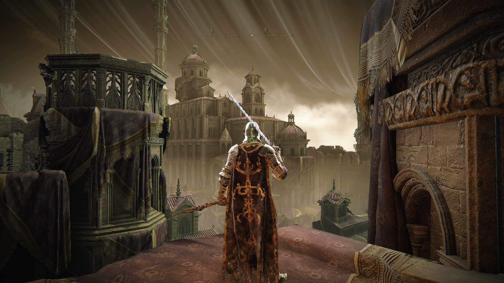

# Twin Lanterns

Lunar Flower’s ReShade screen-space indirect-light project. Twin Lanterns gathers
light from visible surfaces, reconstructs it across compatible geometry, and
limits added light by the configured ceiling and remaining output-channel room.

## Kriegsspinne — Reference Build Candidate 1

**[Download Kriegsspinne RBC1 — ZIP](https://raw.githubusercontent.com/alia-june/Lunar-Flower/main/downloads/Kriegsspinne-Reference-Build-Candidate-1.zip)**

[Installation and comparison presets](Twin-Lanterns/Provider-Performance/README.md)
· [SHA-256](downloads/Kriegsspinne-Reference-Build-Candidate-1.zip.sha256)
· [All downloads](downloads/README.md)

The current reference candidate combines voxel-free DDA/march tracing, cardinal
and diagonal direction tests, one additional bounded bounce, distance decay,
and cached first-light composition. It includes 12 presets for comparing ray
budgets, providers, bounce cost and the cached/recomputed final pass.

### Install

1. Extract the ZIP outside ReShade’s shader search folders.
2. Merge its `reshade-shaders` folder into your game. If already installed,
   replace the existing `lunar_flower_provider_perf` folder. Keep your installed
   `ReShade.fxh`.
3. Load `Twin-Lanterns-ProviderPerf-Cardinal4-EqualTraversal.ini` from the ZIP.
4. Use **Final Image** and enable only this Twin Lanterns technique for comparison.

The ReShade effect remains **Lunar Flower - Twin Lanterns: Provider Performance**
so existing presets stay compatible. For the original 32/16 ray budgets, compare
**Parent32-16** with **Parent32-16-Recomputed** at the same camera position.

CPU/source/package checks cover light bounds, simulated sampling and package
integrity. They do not establish native compilation or GPU performance; the
[C++ / ReShade FX mismatch log](Twin-Lanterns/Provider-Performance/ERROR_LOG.md)
records the corrected reserved-keyword failure and that validation boundary.

## Other builds

| Build | Purpose | Download or details |
|---|---|---|
| **Crystal Spider - Beta + Fog Guard V2** | Earlier voxel-lighting build with Fog Guard Capture → Crystal Spider → Restore and a starter preset | [ZIP](https://raw.githubusercontent.com/alia-june/Lunar-Flower/main/downloads/Crystal-Spider-Beta.zip) · [Setup](docs/CRYSTAL_SPIDER_BUNDLE.md) |
| **Stable 1.4** | Original fixed baseline | [Build](Twin-Lanterns/Stable-1.4/) |
| **Fidelity Overdrive** | Independent fidelity and highlight-protection candidate | [Build](Twin-Lanterns/Fidelity-Overdrive/) |
| **No Voxel** | Dual screen tracing without voxel resources; includes Fog Guard V2 | [ZIP](https://raw.githubusercontent.com/alia-june/Lunar-Flower/main/downloads/Twin-Lanterns-No-Voxel.zip) · [Setup](Twin-Lanterns/No-Voxel/) |
| **Direction Lab / Bounce Lab** | Earlier direction, provider and bounce experiments | [Direction Lab](Twin-Lanterns/Direction-Lab/) · [Bounce Lab](Twin-Lanterns/Bounce-Lab/) |
| **Full Resolution Dual Ray Alpha** | Voxel-proxy research source underlying Crystal Spider | [Build and history](Twin-Lanterns/Full-Resolution-Dual-Ray-Alpha/) |

[Lazara](https://github.com/dastardlyrat/Lazara-Reshade-Revival-Package)
· [Crystal Spider without Fog Guard](https://raw.githubusercontent.com/alia-june/Lunar-Flower/main/downloads/Crystal-Spider-Beta-standalone.zip)
· [Fog Guard V2 setup](development/fog-guard-v2/README.md)

## Gallery

*Earlier Elden Ring capture with Lazara + Twin Lanterns.*

[Gallery and complete comparison frames](Twin-Lanterns/README.md#visual-comparison)
· [Three-state comparison](Twin-Lanterns/assets/twin-lanterns-full-lazara-comparison.png)
· [Comparison evidence](Twin-Lanterns/assets/twin-lanterns-full-lazara-comparison.json)

The captures contain third-party game imagery, outside the MIT software grant.
Effect-state labels are user-supplied; the images do not establish isolated
shader performance or compilation success.

## Research and development

- [Fog- and light-aware shading](docs/FOG_AND_LIGHT_AWARE_SHADING.md): preserve
  atmospheric depth, light color and detail, informed by lessons from
  [miXSR_hexer, now defunct](docs/MIXSR_HEXER_RETIREMENT.md).
- [Shader development Mill](development/mill/README.md): source snapshots,
  working candidates, test evidence and packages.
- [Public API 0.1.0](Twin-Lanterns/API/0.1.0/): versioned ReShade FX include
  contract, [surface registry](Twin-Lanterns/API/0.1.0/PUBLIC_API.json) and
  [declaration reference](Twin-Lanterns/API/0.1.0/REFERENCE.md).
- [Lunar Flower AI Seed](theory/README.md): a separate proposed AI architecture;
  [canonical theory](https://github.com/alia-june/ethical-and-intellectual-theory/blob/main/blue-prints/LUNAR_FLOWER_AI_SEED_EXPERT_SYSTEM_CONTRACT.md).
  It does not describe a capability implemented by these shaders.

Twin Lanterns works with current-frame screen evidence. It cannot recover hidden
or off-screen geometry, and its depth-based lighting is an approximation rather
than complete GI. Added light is nonnegative and bounded; denoising and temporal
stabilization remain external effects. Each build documents its own resources,
validation and practical limits.

## License and authorship

[MIT License](LICENSE). Keep the copyright and license notice with copies or
substantial portions of the software.

Project direction and authorship: **alia june**. Documentation and validation
tooling were prepared with AI assistance under the author’s direction.
