# Twin Lanterns API 0.1.0

Twin Lanterns API 0.1.0 is a versioned ReShade FX include package for bounded,
evidence-bearing screen-space light transport. It exposes the same provider,
transport, reconstruction, and composite contracts used by Twin Lanterns
Stable 1.4, Fidelity Overdrive, and Full Resolution Dual Ray Alpha.

> **Status:** public, pre-1.0, packaged, and structurally validated. A downstream
> consumer still owns its clean ReShade compile, backend compatibility,
> target-game depth behavior, performance measurement, and visual acceptance.

The package is intentionally inspectable. Each stage returns a record of what
was observed, admitted, rejected, weighted, and bounded—not only a final color.

## What This Package Is

- A source-level include API for ReShade FX.
- A fixed `0.1.0` directory that can be pinned by consumers.
- Eight shared source files copied from the Stable 1.4 canonical baseline.
- Four published stage contracts with twelve registered type, constructor, and
  entrypoint symbols.
- A machine-readable [contract registry](PUBLIC_API.json), a literal
  [version marker](VERSION), [SHA-256 inventory](SHA256SUMS.txt), and
  [declaration index](SYMBOLS.json).

## Documentation Map

- [Architecture and integration guide](README.md) — lifecycle, stages,
  installation, examples, diagnostics, stability, and validation boundary.
- [Complete declaration reference](REFERENCE.md) — every packaged macro,
  struct, scoped field, function signature, resource, and experimental symbol.
- [Machine-readable symbol index](SYMBOLS.json) — deterministic declaration
  inventory for review and tooling.
- [Contract registry](PUBLIC_API.json) — the twelve stable shared symbols,
  source lineage, experimental boundary, and package metadata.

It is not a binary ABI, a web API, a complete effect, a preset, a denoiser, a
temporal accumulator, or a promise of game-specific depth compatibility.

## Architecture

```mermaid
flowchart LR
    A["ReShade back buffer + linearized depth"] --> B["Capability and surface guide"]
    B --> C["Provider evidence<br/>ray + hit + reason + confidence"]
    C --> D["Dual-provider transport<br/>DDA + parametric march"]
    D --> E["RGBA working field<br/>RGB radiance + A evidence"]
    E --> F["Surface reconstruction<br/>depth + normal + edge gates"]
    F --> G["Bounded composite<br/>admission + ceiling + channel room"]
    G --> H["Final RGB + diagnostic evidence"]
```



The architecture separates four questions:

1. **Did a provider produce a defensible hit?**
2. **Did one or both transport providers produce admissible donor light?**
3. **Can neighboring evidence be reconstructed on the same surface?**
4. **How much nonnegative light may be added without violating the ceiling or
   the remaining normalized output range?**

No stage upgrades missing evidence into valid black light. Invalid receivers,
rays, hits, donors, or reconstruction taps remain inspectable rejection states.

## Package Layout

```text
API/0.1.0/
  README.md
  REFERENCE.md
  SYMBOLS.json
  VERSION
  PUBLIC_API.json
  SHA256SUMS.txt
  reshade-shaders/
    Shaders/camera_obscura/
      api/
        CAMERA_OBSCURA_API_TwinLanternComposite.fxh
        CAMERA_OBSCURA_API_TwinLanternProviderProofCommon.fxh
        CAMERA_OBSCURA_API_TwinLanternReconstruction.fxh
        CAMERA_OBSCURA_API_TwinLanternTransport.fxh
      header/
        CAMERA_OBSCURA_AtomicCommon.fxh
        CAMERA_OBSCURA_AtomicDebug.fxh
        CAMERA_OBSCURA_EntryCapability.fxh
        CAMERA_OBSCURA_EntryTraversal.fxh
  experimental/
    README.md
    LUNAR_FLOWER_API_TwinLanternVoxelProxy.fxh
```

The `experimental` directory is distributed for Alpha integration and review.
It is not part of the shared 0.1.0 stability contract.

## Install And Include

Copy the package's `reshade-shaders` directory into the target ReShade
installation. It contributes only include files; it does not install a
technique or preset.

The target installation must supply a compatible `ReShade.fxh`. From an effect
inside `Shaders/camera_obscura/effects`, include:

```hlsl
#include "ReShade.fxh"
#include "../api/CAMERA_OBSCURA_API_TwinLanternComposite.fxh"
```

`CAMERA_OBSCURA_API_TwinLanternComposite.fxh` is the umbrella entrypoint. Its
local include closure loads all eight shared files:

```text
TwinLanternComposite
  -> TwinLanternReconstruction
     -> TwinLanternTransport
        -> TwinLanternProviderProofCommon
           -> EntryCapability
              -> AtomicCommon
           -> AtomicDebug
              -> AtomicCommon
        -> EntryTraversal
           -> EntryCapability
```

The capability layer reads `ReShade::BackBuffer` and
`ReShade::GetLinearizedDepth`. A consumer without a usable depth buffer has no
valid receiver surface and should fail closed.

## Public Contract Surface

The registry names the supported surface. Other prefixed helpers remain
readable and callable, but 0.1.0 does not yet promise them as stable entrypoints.

| Stage | Evidence type | Default constructor | Main entrypoint |
|---|---|---|---|
| Provider | `CAMERA_OBSCURA_API_TwinLanternProviderEvidence` | `CAMERA_OBSCURA_API_DefaultTwinLanternProviderEvidence` | `CAMERA_OBSCURA_API_BuildTL45Evidence` |
| Transport | `CAMERA_OBSCURA_API_TwinLanternTransportEvidence` | `CAMERA_OBSCURA_API_DefaultTwinLanternTransportEvidence` | `CAMERA_OBSCURA_API_BuildTwinLanternTransportEvidence` |
| Reconstruction | `CAMERA_OBSCURA_API_TL08ResolveEvidence` | `CAMERA_OBSCURA_API_DefaultTL08ResolveEvidence` | `CAMERA_OBSCURA_API_ResolveTL08Axis` |
| Composite | `CAMERA_OBSCURA_API_TL09CompositeEvidence` | `CAMERA_OBSCURA_API_DefaultTL09CompositeEvidence` | `CAMERA_OBSCURA_API_BuildTL09Composite` |

`TL45`, `TL07`, `TL08`, and `TL09` are retained stage identifiers. They are
part of the published symbol spelling; they are not API version numbers.

## Stage Contracts

### 1. Provider evidence

`CAMERA_OBSCURA_API_BuildTL45Evidence` describes one trace provider. Its result
records:

- backend and requested step budget;
- receiver and ray validity;
- direction, hit state, terminal reason, and hit UV;
- interval support and effective thickness;
- coarse and refined residuals;
- refinement behavior and confidence.

Provider evidence is diagnostic. It does not by itself authorize a composite.

### 2. Dual-provider transport

`CAMERA_OBSCURA_API_BuildTwinLanternTransportEvidence` builds a receiver ray,
evaluates DDA and parametric march independently, refines both results, and
tests donor compatibility. The returned record contains each provider's donor
color, distance, facing, compatibility, confidence, raw weight, normalized
weight, provider-count state, and combined radiance.

The public transport modes are:

```hlsl
CAMERA_OBSCURA_API_TL07_MODE_PARITY
CAMERA_OBSCURA_API_TL07_MODE_COMPLEMENTARY
```

Complementary mode admits the independently supported providers. No usable
weight produces `zero_contribution`, not invented radiance.

### 3. Surface reconstruction

`CAMERA_OBSCURA_API_ResolveTL08Axis` resolves a negative, center, and positive
sample along one axis. Each neighbor is gated by:

- explicit availability;
- prior alpha evidence;
- receiver validity;
- depth compatibility;
- reconstructed-normal agreement;
- edge-risk protection.

The result returns reconstructed RGB, trusted weight, admitted weights, minimum
surface support, and the zero-weight state. Consumers normally run it once per
axis, using an RGBA working field where RGB is donor radiance and alpha is
evidence.

### 4. Bounded composite

`CAMERA_OBSCURA_API_BuildTL09Composite` is the authority boundary. Its contract
is:

```text
admission = enabled * receiver valid * usable evidence * nonzero strength
requested = indirect RGB * evidence * strength * admission
channel ceiling = min(maximum contribution, 1 - source RGB)
bounded contribution = clamp(requested, 0, channel ceiling)
final RGB = source RGB + bounded contribution
```

The result retains source, indirect, weighted, bounded, remaining-room, final,
admission, rejection, containment, and bounds evidence. It cannot subtract
from the source or add beyond the configured and per-channel ceilings.

## Minimal Bounded-Composite Integration

```hlsl
CAMERA_OBSCURA_API_TL09CompositeEvidence composite =
    CAMERA_OBSCURA_API_BuildTL09Composite(
        sourceRgb,
        reconstructedIndirectRgb,
        reconstructedEvidence,
        receiverValid,
        effectEnabled,
        effectStrength,
        maximumAddedLight);

return float4(composite.final_rgb, 1.0);
```

For diagnostics, route fields such as `composite.admission`,
`composite.rejection_code`, `composite.containment_activity`, or
`composite.bounds_valid` to a debug view instead of discarding them.

## Data Conventions

| Value | Convention |
|---|---|
| UV coordinates | Normalized screen coordinates; helper functions saturate them before loads. |
| Depth | ReShade linearized depth normalized to the installed depth configuration. |
| Color | Normalized RGB expected by the bounded SDR composite contract. |
| Evidence | `0..1`; zero means unsupported, not valid darkness. |
| Boolean state | Float masks using `0.0` and `1.0` for ReShade FX compatibility. |
| Working field | RGB carries donor radiance; alpha carries evidence. |
| Direction index | Eight compass directions, clamped to indices `0..7`. |

The shared contract assumes normalized SDR channel room. An HDR or differently
encoded consumer must adapt the composite boundary explicitly rather than
silently reusing the SDR ceiling.

## Failure And Recovery

| Condition | Contract result | Consumer response |
|---|---|---|
| Missing or invalid depth | Invalid receiver; no admitted transport | Fix ReShade depth configuration or disable the effect. |
| Zero direction or invalid ray | Provider rejection reason | Inspect direction and trace controls. |
| No provider hit | Zero donor evidence | Preserve the source image. |
| Surface-incompatible neighbor | Neighbor excluded from resolve | Keep center evidence or emit an empty field. |
| No reconstruction weight | `zero_weight = 1` | Do not treat the output as supported black light. |
| Disabled effect or zero strength | Composite rejection | Return the source unchanged. |
| No remaining channel room | Zero contribution for that channel | Preserve the saturated source channel. |

The API has no temporal state, so disabling and re-enabling it requires no
history reset. Rollback is file-level: remove the versioned includes and return
the consumer to its previous include set.

## Compatibility

| Surface | 0.1.0 position |
|---|---|
| ReShade FX | Required consumer language. |
| `ReShade.fxh` | Required from the target installation; not bundled. |
| Back buffer | Required by the capability entry layer. |
| Linearized depth | Required for receiver, guide, and trace evidence. |
| Motion vectors | Not used. |
| Temporal history | Not used. |
| Compute shaders | Not required by the eight-file shared API. |
| 3D storage | Not required by the shared API; required only by the experimental voxel extension. |

The source package is structurally portable, but backend and game behavior are
not inferred from static source. A consumer must compile and exercise its own
effect on the intended ReShade version and graphics backend.

## Experimental Voxel Extension

The byte-identical Alpha extension in [`experimental/`](experimental/) exposes:

- `LUNAR_FLOWER_API_TwinLanternVoxelEvidence`;
- `LUNAR_FLOWER_API_DefaultTwinLanternVoxelEvidence`;
- `LUNAR_FLOWER_API_LoadTwinLanternVoxelSurface`;
- `LUNAR_FLOWER_API_TraceTwinLanternVoxelProxy`;
- `LUNAR_FLOWER_API_TwinLanternVoxelDetailLevel`.

It also declares the Alpha's compute kernel, 3D texture, storage view, and
sampler. Include the shared umbrella first. The extension requires compute and
`storage3D` support and remains outside the 0.1.0 stability promise.

Its `64 x 36 x 21` RGBA32F atlas stores a bounded adaptive current-frame,
camera-visible depth shell with two subdivision levels. The texture's Z axis
indexes tree nodes. Record components X/Y store sampled depth bounds, Z stores
coverage and W stores signed center depth (-1 marks a branch). The old uniform
depth-bin representation is superseded under this experimental contract. Final
lighting uses a full-resolution depth-validated donor color, and a separate
detail-level function exposes selected refinement for diagnostics. It is
not world voxelization and contains no hidden or off-screen geometry, temporal
persistence, multi-bounce solution, or complete global illumination.

## Lineage And Integrity

Stable 1.4 is the canonical source for the eight shared files. Fidelity
Overdrive and Full Resolution Dual Ray Alpha contain source-identical shared
text. This package preserves that canonical source. `PUBLIC_API.json` and
`SHA256SUMS.txt` record the LF-normalized bytes stored in the public Git blobs,
so the hashes match raw repository downloads independent of Windows checkout
line endings.

Hashes prove package byte identity only. They do not prove downstream compile
success, runtime correctness, authorship identity, or visual acceptance.

## Versioning Policy

- `0.1.0` is public but pre-1.0.
- The versioned source payload, stable contract declarations, marker, and hash
  inventory are immutable after publication.
- A breaking symbol, path, signature, semantic, or struct-contract change
  requires a new version directory and migration note.
- Additive documentation and documentation metadata may clarify the contract
  without changing the versioned source payload or redefining the published
  surface.
- Visible helpers not listed in `PUBLIC_API.json` remain implementation-accessible
  but are not yet stable promises.
- Experimental `LUNAR_FLOWER_API_*` surfaces may change before promotion.

## Validation

From the repository root:

```powershell
python -B tools/validate_showcase_and_public_api.py
python -B tools/build_api_symbol_index.py --check
python -B tools/build_api_reference.py --check
python -B tools/validate_publication.py
python -B tools/validate_full_resolution_dual_ray_alpha.py
```

The API validator checks:

- versioned package, registry, version marker, and hash inventory;
- all eight packaged shared source files and their SHA-256 values;
- local umbrella-include closure;
- source identity against Stable, Fidelity Overdrive, and Alpha;
- all twelve registered contract symbols;
- deterministic declaration-index currency and registry coverage counts;
- complete reference coverage for every packaged macro, struct, scoped field,
  function, and resource;
- experimental voxel-extension identity and boundary;
- public README links.

Static validation does **not** establish a clean downstream ReShade compile,
graphics-backend compatibility, target-game depth correctness, frame time,
voxel correctness, or visual acceptance. Those remain live integration gates.

## License And Attribution

The API sources are published under the repository's [MIT license](../../../LICENSE).
Project direction and authorship: **alia june**. Documentation and validation
tooling were prepared with AI assistance under the author's direction.
