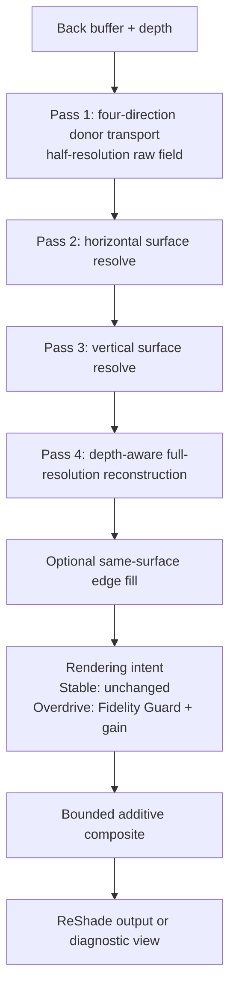

# Twin Lanterns

Twin Lanterns is Lunar Flower's bounded screen-space indirect-light family for
ReShade. The project favors visible evidence and controlled reconstruction over
unbounded brightness or hidden temporal state.

## Visual Comparison


Left: **No Effect** · Center: **Twin Lanterns Only** · Right: **Lazara + Twin Lanterns**

The comparison is assembled from exact vertical thirds of three aligned source
captures. Its [evidence manifest](assets/twin-lanterns-three-way-comparison.json)
records the source hashes and verifies every output region against its source.
It is documentation evidence containing third-party game imagery, which is not
included in the repository's MIT software grant.

## Gallery

These additional user-supplied captures are preserved byte-for-byte. Capture 01
is identified as using [FlexAgX by
El-Greco1541](https://github.com/El-Greco1541/FlexAgX). Captures 02 and 03 have
no supplied effect, preset, or variant assignment, so the gallery is not
presented as a controlled comparison. The [gallery
manifest](assets/twin-lanterns-gallery.json) records the supplied assignment,
source filenames, dimensions, and matching source/repository hashes.

### Capture 01 — using FlexAgX by El-Greco1541

[](https://github.com/El-Greco1541/FlexAgX)

FlexAgX is credited and linked as part of this capture's effect context; it is
not bundled or vendored by Lunar Flower.

### Capture 02


### Capture 03


Like the comparison above, these captures contain third-party game imagery and
are not included in the repository's MIT software grant.

## Architecture

Twin Lanterns is an ordered four-pass frame graph. Both builds use the same
transport, reconstruction, and composite contracts, the same three
half-resolution working textures, and the same surface-evidence tests. The
Fidelity Overdrive build adds a rendering-intent transform after
reconstruction; it does not replace the shared light-transport path or the
final composite bound.



The reconstruction, edge-fill, intent, and composite stages all execute inside
the fourth ReShade pass. They are shown separately above to make data ownership
and the order of operations visible.

### Frame graph

| Pass | Reads | Writes | Responsibility |
|---|---|---|---|
| 1. Transport | Back buffer, depth | Raw field | Trace east, north, west, and south; admit valid donor color and evidence; combine the accepted directional samples. |
| 2. Horizontal resolve | Raw field, depth | Horizontal field | Resolve across the surface while gating taps by coverage, depth, reconstructed normal, edge risk, and existing evidence. |
| 3. Vertical resolve | Horizontal field, depth | Vertical field | Apply the same evidence-gated resolve on the second axis. |
| 4. Composite | Vertical field, back buffer, depth | ReShade output | Reconstruct at full resolution, optionally fill supported edge deficits, apply build-specific intent, enforce the contribution bounds, and select the requested diagnostic view. |

The raw, horizontal, and vertical fields are half-resolution `RGBA16F`
textures with point-clamped samplers. RGB carries reconstructed donor color;
alpha carries its evidence. They are current-frame working fields, not temporal
history.

### Transport and evidence

Each transport sample builds a receiver from the depth buffer, traces a ray,
refines the hit, and evaluates the donor at the hit position. A donor weight is
formed from hit confidence, donor depth confidence, receiver/donor normal
compatibility, and distance falloff. Invalid receivers, rays, hits, or donors
therefore contribute no usable evidence.

The effect evaluates the four cardinal directions and averages only their
evidence-weighted donor samples. Reconstruction preserves that explicit
evidence channel: unsupported neighbors are excluded rather than being treated
as valid black light.

### Reconstruction and edge fill

The horizontal and vertical resolves are separable, but they are not ordinary
image blurs. Every neighboring tap must remain compatible with the center
surface under the configured depth, normal, coverage, and edge-protection
tests. If no supported weight remains, the resolve emits an empty field.

The fourth pass then evaluates the four surrounding half-resolution cells for
each full-resolution receiver and applies the same surface tests during
upsampling. Edge Fill, when enabled, samples only this reconstructed field. It
adds a positive same-surface deficit near eligible edges; it does not read new
light from the back buffer, cross a rejected surface boundary, or subtract from
the indirect field. A zero Edge Fill strength is an immediate bypass.

### Intent and bounded composition

Stable 1.4 passes the reconstructed indirect field to the composite unchanged.
Fidelity Overdrive can first align that field toward the receiver's current
color direction, reduce pressure near occupied highlights, and request up to
`3x` gain. This intent stage does not grant authority to bypass admission or
output limits.

For both builds, the composite follows the same contract:

```text
admission = enabled * valid receiver * usable evidence * nonzero strength
requested = indirect RGB * evidence * effective strength * admission
channel ceiling = min(Maximum Added Light, 1 - source RGB)
bounded contribution = clamp(requested, 0, channel ceiling)
final RGB = source RGB + bounded contribution
```

Consequently, the effect cannot subtract from the source, exceed the configured
maximum contribution, or add beyond the unused room in a normalized output
channel.

### Rejection and recovery behavior

| Condition | Result |
|---|---|
| Invalid depth receiver or ray | No transport admission |
| No accepted donor evidence | Empty reconstructed field |
| Surface-incompatible resolve tap | Tap excluded from the resolve |
| Edge Fill set to zero | Edge-fill stage bypassed |
| Technique disabled or effective strength zero | No applied contribution |
| No remaining channel room | Contribution for that channel is zero |
| Technique disabled and re-enabled | No history to recover or invalidate |

## Builds

### Stable 1.4

[Stable-1.4](Stable-1.4/) is the fixed baseline. It retains the original Camera
Obscura public identifiers for preset compatibility and includes optional Edge
Ink and same-surface Edge Fill.

### Fidelity Overdrive

[Fidelity-Overdrive](Fidelity-Overdrive/) is a separately named public
candidate. It adds two independent rendering-intent controls:

- **Fidelity Guard** aligns indirect light toward the receiver's existing color
  direction and reduces pressure near occupied highlights.
- **Overdrive** raises requested energy from `1x` to `3x` before the existing
  hard contribution and channel-room limits.

Both controls may run together. At zero/zero, their intent stage reproduces the
pre-overdrive path.

## Source Ownership

The public builds deliberately separate effect identity from shared behavior:

| Layer | Owner | Change policy |
|---|---|---|
| Public effect, uniforms, technique, diagnostics | [Stable effect](Stable-1.4/reshade-shaders/shaders/camera_obscura/effects/CAMERA_OBSCURA_TwinLantern.fx) and [Fidelity Overdrive effect](Fidelity-Overdrive/reshade-shaders/Shaders/camera_obscura/effects/LUNAR_FLOWER_TwinLanterns_FidelityOverdrive.fx) | Stable identifiers stay fixed; candidate identifiers remain distinct. |
| Transport | [Transport API](Stable-1.4/reshade-shaders/shaders/camera_obscura/api/CAMERA_OBSCURA_API_TwinLanternTransport.fxh) and [provider-proof API](Stable-1.4/reshade-shaders/shaders/camera_obscura/api/CAMERA_OBSCURA_API_TwinLanternProviderProofCommon.fxh) | Shared and source-identical between builds. |
| Reconstruction | [Reconstruction API](Stable-1.4/reshade-shaders/shaders/camera_obscura/api/CAMERA_OBSCURA_API_TwinLanternReconstruction.fxh) | Shared and source-identical between builds. |
| Composite bounds | [Composite API](Stable-1.4/reshade-shaders/shaders/camera_obscura/api/CAMERA_OBSCURA_API_TwinLanternComposite.fxh) | Shared and source-identical between builds. |
| Atomic, debug, capability, and traversal support | [Four Camera Obscura headers](Stable-1.4/reshade-shaders/shaders/camera_obscura/header/) | Shared and source-identical between builds. |

This yields eight source-identical API/header files in each package. Fidelity
Overdrive refactors only its public identity and its post-reconstruction intent
stage; Stable 1.4 remains the rollback baseline.

The denoiser is deliberately absent. Run external denoising or stabilization as
a separate ReShade technique so Twin Lanterns remains inspectable and can be
disabled without retaining history.

## Installation

Choose one build, then merge its `reshade-shaders` directory into the target
ReShade installation. The effect expects the installation's working
`ReShade.fxh` and a usable depth buffer.

Stable technique:

```text
Camera Obscura - Twin Lantern
```

Fidelity Overdrive technique:

```text
Lunar Flower - Twin Lanterns: Fidelity Overdrive
```

## Validation Boundary

The repository validator confirms local include closure, initialized public
controls, diagnostic coverage, the ordered four-pass graph, source/channel
bounds, same-surface edge-fill behavior, absence of active denoiser resources,
and the eight unchanged shared API/header files. Stable exposes 14 controls and
12 diagnostic views; Fidelity Overdrive exposes 16 controls and 14 diagnostic
views.

It does not establish full ReShade compilation, game-specific depth behavior,
acceptable frame time, or visual acceptance. Those remain live gates described
inside each build.

## Development Rules

- Preserve the fixed baseline unless a change is explicitly promoted.
- Add experiments beside Stable rather than silently replacing it.
- Keep source observations, generated implementation, validation, and human
  acceptance distinguishable.
- Preserve the MIT license and authorship notice in distributions.
