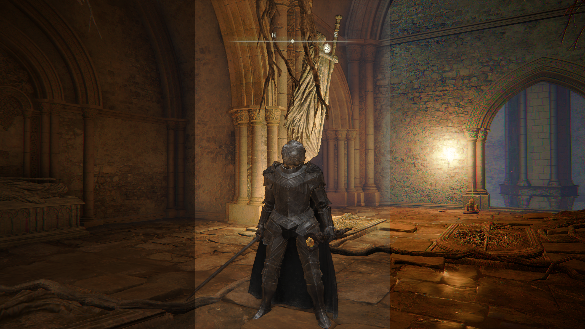
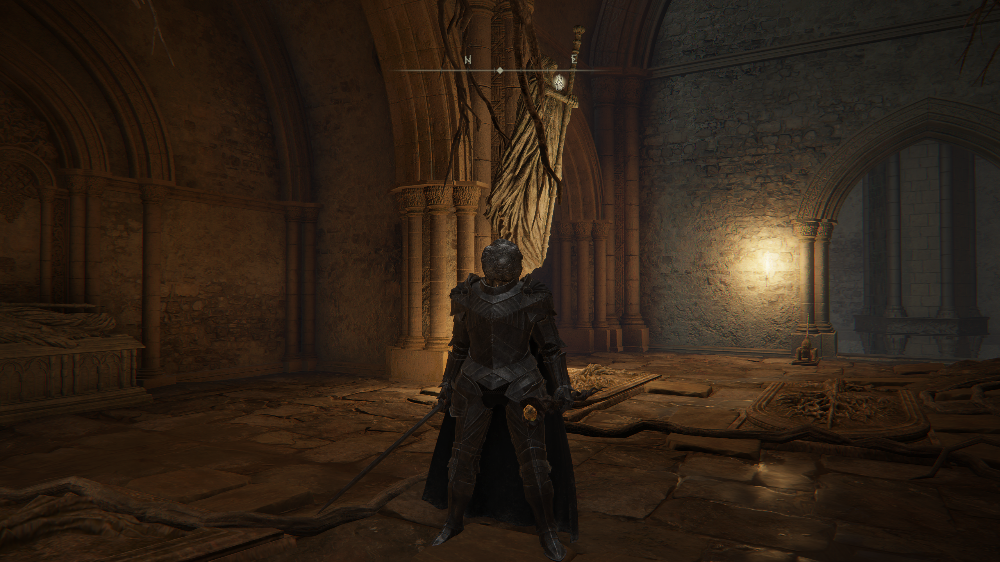
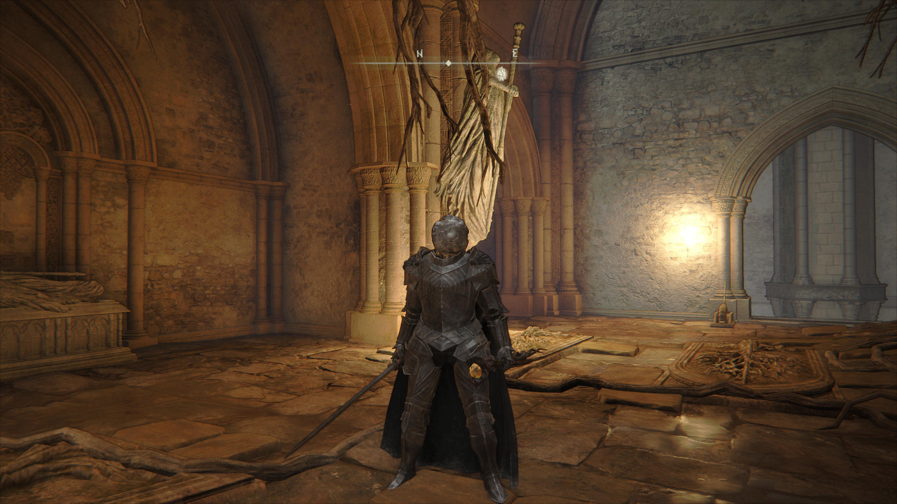
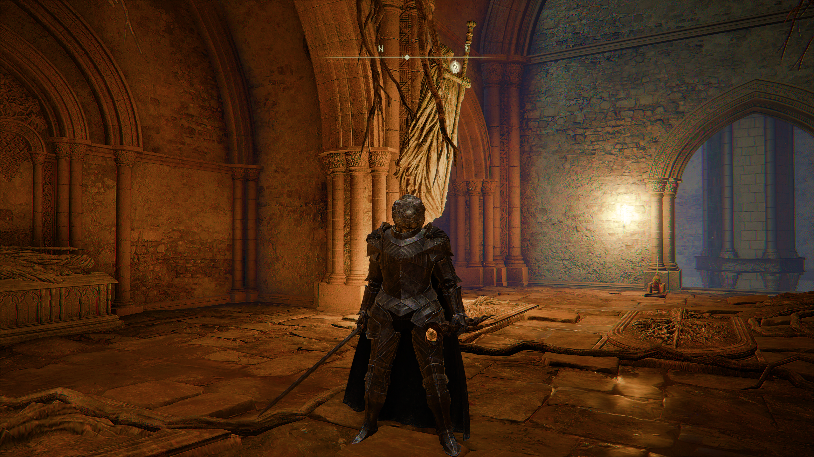
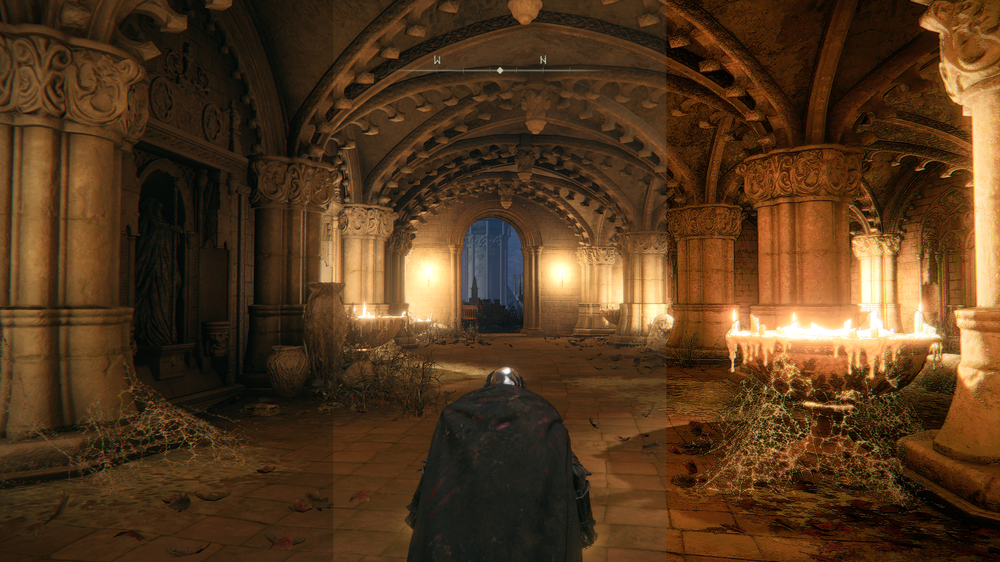
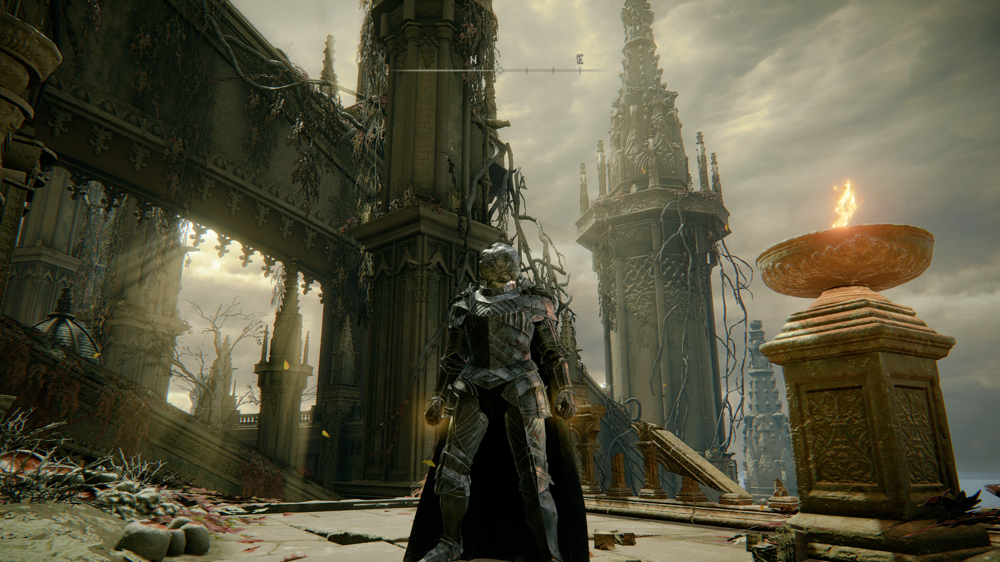
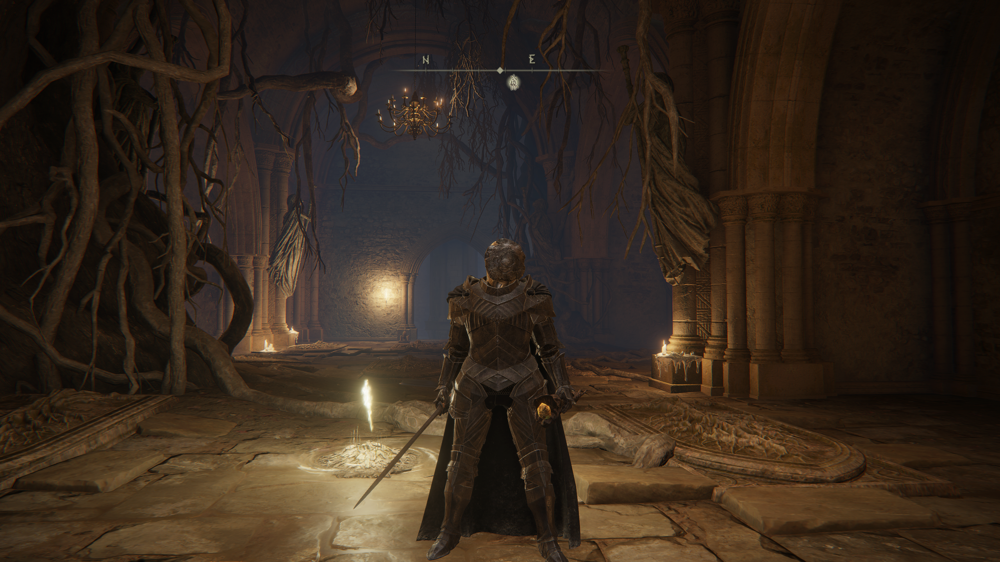
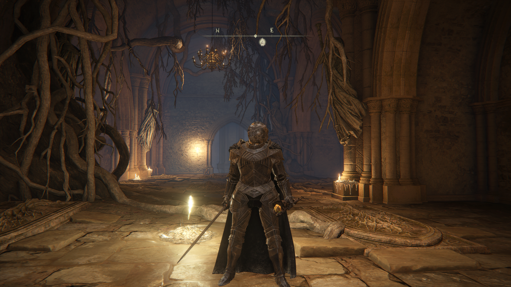
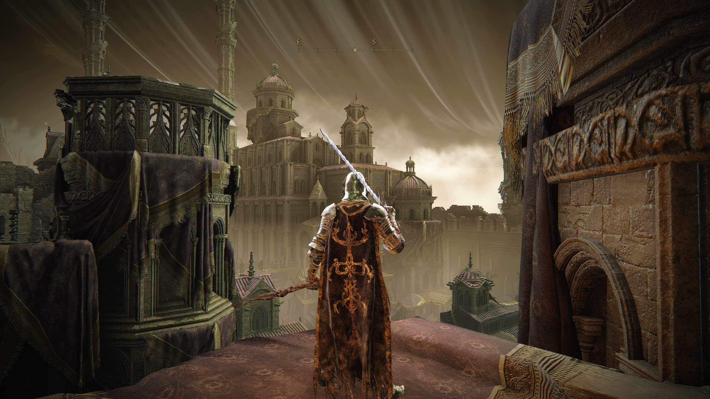
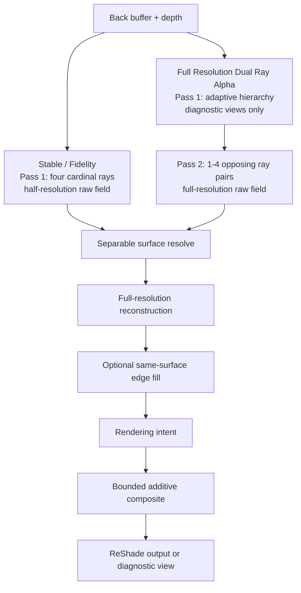

# Twin Lanterns

**[Download Crystal Spider - Beta + Fog Guard — ZIP](https://raw.githubusercontent.com/alia-june/Lunar-Flower/main/downloads/Crystal-Spider-Beta.zip)** · [Lazara](https://github.com/dastardlyrat/Lazara-Reshade-Revival-Package) · [Installation and package details](../downloads/README.md#crystal-spider---beta)

Twin Lanterns is Lunar Flower's bounded screen-space indirect-light family for
ReShade. The project favors visible evidence and controlled reconstruction over
unbounded brightness or hidden temporal state.

[Twin Lanterns No Voxel](No-Voxel/) is a separate screen-only test build.
It retains dual screen tracing, depth fade and light softening while removing
voxel lighting, its compute pass and 3D resources. The
[test package](../downloads/Twin-Lanterns-No-Voxel.zip) includes unchanged Fog
Guard V2 and a matching starter preset. Native compilation and game testing
remain pending.

[Direction Lab](Direction-Lab/) adds an isolated cardinal-versus-diagonal
experiment with fixed per-provider sampling budgets, direction-independent
depth travel, and DDA/march hit, donor and weighted-light views.
[Download the test package](../downloads/Twin-Lanterns-DirectionLab.zip).

Twin Lanterns is part of our beginning work on
[fog- and light-aware shading](../docs/FOG_AND_LIGHT_AWARE_SHADING.md), informed
by lessons from miXSR_hexer. The combined download includes Fog Guard V2 and an
[ordered starter preset](../docs/CRYSTAL_SPIDER_BUNDLE.md) around Crystal Spider; native fog/light mask integration
inside every shader remains future work.

## Visual Comparison



Left: **No Effects** · Center: **Twin Lanterns Full** · Right: **Twin Lanterns Full + Lazara**

The comparison is assembled from exact corresponding vertical thirds of three
aligned source captures. Its [evidence manifest](assets/twin-lanterns-full-lazara-comparison.json)
records the byte-identical source copies, composition coordinates, hashes, and
decoded-region verification. Effect-state labels are user-supplied. The image
does not establish isolated technique causality, compile success, or
performance.

### Complete source frames

#### No Effects



#### Twin Lanterns Full



#### Twin Lanterns Full + Lazara



These captures contain third-party game imagery and are not included in the
repository's MIT software grant.

### Earlier three-state comparison



The earlier **No Effect / Twin Lanterns Only / Lazara + Twin Lanterns** set and
its [evidence manifest](assets/twin-lanterns-three-way-comparison.json) remain
available as a separate capture sequence.

## Gallery

These additional user-supplied captures are preserved byte-for-byte. Capture 01
is identified as using [FlexAgX by
El-Greco1541](https://github.com/El-Greco1541/FlexAgX). Capture 02 is identified
as **No Effects**, Capture 03 as **Light Controlled Twin Lanterns**, and Capture
04 as **Lazara + Twin Lanterns** in Elden Ring. The
[gallery manifest](assets/twin-lanterns-gallery.json) records these supplied
assignments, source filenames, dimensions, and matching source/repository
hashes.

### Capture 01 — using FlexAgX by El-Greco1541

[](https://github.com/El-Greco1541/FlexAgX)

FlexAgX is credited and linked as part of this capture's effect context; it is
not bundled or vendored by Lunar Flower.

### Two-way presentation

Captures 02 and 03 show the supplied No Effects and Light Controlled Twin
Lanterns states. They are presented as complete frames, not as a registered
pixel-level A/B comparison.

#### Capture 02 — No Effects



#### Capture 03 — Light Controlled Twin Lanterns



### Capture 04 — Lazara + Twin Lanterns

[](assets/twin-lanterns-gallery-04.png)

An original 2560×1440 Elden Ring capture, also featured on the
[Crystal Spider - Beta download page](../downloads/README.md#crystal-spider---beta).

Like the comparison above, these captures contain third-party game imagery and
are not included in the repository's MIT software grant.

## Architecture

Stable 1.4 and Fidelity Overdrive use an ordered four-pass frame graph with
three half-resolution working fields. Full Resolution Dual Ray Alpha is a separate
five-pass candidate: its first pass builds a current-frame diagnostic proxy
only for voxel diagnostic views,
then runs the same three working fields at full resolution with a variable
opposing-ray schedule. All three builds retain the same surface-evidence and
bounded-composite contracts.



For Stable and Fidelity Overdrive, reconstruction, edge fill, intent, and
composition execute inside pass four. For Full Resolution Dual Ray Alpha they execute
inside pass five, after the voxel build, full-resolution transport, and two
resolve passes.

### Frame graph

| Pass | Reads | Writes | Responsibility |
|---|---|---|---|
| 1. Transport | Back buffer, depth | Raw field | Trace east, north, west, and south; admit valid donor color and evidence; combine the accepted directional samples. |
| 2. Horizontal resolve | Raw field, depth | Horizontal field | Resolve across the surface while gating taps by coverage, depth, reconstructed normal, edge risk, and existing evidence. |
| 3. Vertical resolve | Horizontal field, depth | Vertical field | Apply the same evidence-gated resolve on the second axis. |
| 4. Composite | Vertical field, back buffer, depth | ReShade output | Reconstruct at full resolution, optionally fill supported edge deficits, apply build-specific intent, enforce the contribution bounds, and select the requested diagnostic view. |

Full Resolution Dual Ray Alpha prepends a compute voxel-build pass and shifts the
four operations above to passes 2-5. Its raw and resolve fields are
full-resolution `RGBA16F`; the other builds retain half resolution. In every
build RGB carries donor color and alpha carries its evidence. These are
current-frame working fields, not temporal history.

### Voxel proxy boundary

Full Resolution Dual Ray Alpha builds a bounded adaptive visible-depth hierarchy
with `64 x 36` root tiles and two optional subdivision levels. A `64 x 36 x 21`
`RGBA32F` atlas stores nodes with signed depth; Z indexes tree nodes rather than
uniform depth bins. Tiles split on sampled depth/coverage/color changes. This
atlas is diagnostic data: sparse probe bounds cannot veto lighting. Ray
candidates require full-resolution depth validation and fetch donor color at the
accepted UV, instead of applying one coarse cell color to the whole tile.

This is **view-frustum voxel lighting**, not world voxelization. It contains no
hidden or off-screen geometry, does not persist across frames, and makes no
claim of complete or multi-bounce GI. The pass requires ReShade compute and
`storage3D` support.

### Transport and evidence

Each transport sample builds a receiver from the depth buffer, traces a ray,
refines the hit, and evaluates the donor at the hit position. A donor weight is
formed from hit confidence, donor depth confidence, receiver/donor normal
compatibility, and distance falloff. Invalid receivers, rays, hits, or donors
therefore contribute no usable evidence.

Stable and Fidelity Overdrive evaluate four cardinal directions. Full
Resolution Dual Ray evaluates one to four opposing pairs: two pairs reproduce
the cardinals, while pairs three and four add both diagonals. Each direction
still runs the DDA and parametric-march providers independently, then may admit
voxel-proxy radiance. Reconstruction preserves the explicit evidence channel:
unsupported providers and neighbors are excluded rather than treated as valid
black light.

### Reconstruction and edge fill

The horizontal and vertical resolves are separable, but they are not ordinary
image blurs. Every neighboring tap must remain compatible with the center
surface under the configured depth, normal, coverage, and edge-protection
tests. If no supported weight remains, the resolve emits an empty field.

Stable and Fidelity Overdrive evaluate the four surrounding half-resolution
cells for each full-resolution receiver. Full Resolution Dual Ray Alpha already has
a one-to-one full-resolution transport field and therefore reads the resolved
receiver directly. Edge Fill, when enabled, samples only the reconstructed
field. It adds a positive same-surface deficit near eligible edges; it does not
read new light from the back buffer, cross a rejected surface boundary, or
subtract from the indirect field. A zero Edge Fill strength is an immediate
bypass.

### Intent and bounded composition

Stable 1.4 passes the reconstructed indirect field to the composite unchanged.
Fidelity Overdrive and Full Resolution Dual Ray Alpha can first align that field
toward the receiver's current color direction, reduce pressure near occupied
highlights, and request up to `3x` gain. This intent stage does not grant
authority to bypass admission or output limits.

For every build, the composite follows the same contract:

```text
admission = enabled * valid receiver * usable evidence * nonzero strength
requested = indirect RGB * evidence * effective strength * admission
channel ceiling = min(Maximum Added Light, 1 - source RGB)
bounded contribution = clamp(requested, 0, channel ceiling)
final RGB = source RGB + bounded contribution
```

Consequently, the effect cannot subtract from the source, exceed the configured
maximum contribution, or add beyond the unused room in a normalized output
channel.

### Rejection and recovery behavior

| Condition | Result |
|---|---|
| Invalid depth receiver or ray | No transport admission |
| No accepted donor evidence | Empty reconstructed field |
| Surface-incompatible resolve tap | Tap excluded from the resolve |
| Edge Fill set to zero | Edge-fill stage bypassed |
| Technique disabled or effective strength zero | No applied contribution |
| No remaining channel room | Contribution for that channel is zero |
| Technique disabled and re-enabled | No history to recover or invalidate |

## Builds

### Stable 1.4

[Stable-1.4](Stable-1.4/) is the fixed baseline. It retains the original Camera
Obscura public identifiers for preset compatibility and includes optional Edge
Ink and same-surface Edge Fill.

### Fidelity Overdrive

[Fidelity-Overdrive](Fidelity-Overdrive/) is a separately named public
candidate. It adds two independent rendering-intent controls:

- **Fidelity Guard** aligns indirect light toward the receiver's existing color
  direction and reduces pressure near occupied highlights.
- **Overdrive** raises requested energy from `1x` to `3x` before the existing
  hard contribution and channel-room limits.

Both controls may run together. At zero/zero, their intent stage reproduces the
pre-overdrive path.

### Full Resolution Dual Ray Alpha

[Full-Resolution-Dual-Ray-Alpha](Full-Resolution-Dual-Ray-Alpha/) is a public
alpha candidate. It adds full-resolution working fields, `1-4`
opposing ray pairs (`2-8` rays), and a compute-built view-frustum voxel-radiance
proxy. Its dedicated static validator passes, but full ReShade compilation,
performance measurement, voxel correctness, and live visual acceptance remain
pending.

## Source Ownership

The public builds deliberately separate effect identity from shared behavior:

| Layer | Owner | Change policy |
|---|---|---|
| Public effect, uniforms, technique, diagnostics | [Stable effect](Stable-1.4/reshade-shaders/shaders/camera_obscura/effects/CAMERA_OBSCURA_TwinLantern.fx), [Fidelity Overdrive effect](Fidelity-Overdrive/reshade-shaders/Shaders/camera_obscura/effects/LUNAR_FLOWER_TwinLanterns_FidelityOverdrive.fx), and [Full Resolution Dual Ray Alpha effect](Full-Resolution-Dual-Ray-Alpha/reshade-shaders/Shaders/camera_obscura/effects/LUNAR_FLOWER_TwinLanterns_FullResolutionDualRayAlpha.fx) | Stable identifiers stay fixed; candidate identifiers remain distinct. |
| View-frustum voxel proxy | [Voxel-proxy API](Full-Resolution-Dual-Ray-Alpha/reshade-shaders/Shaders/camera_obscura/api/LUNAR_FLOWER_API_TwinLanternVoxelProxy.fxh) | Exists only in the full-resolution candidate and remains explicitly camera-visible/current-frame. |
| Transport | [Transport API](Stable-1.4/reshade-shaders/shaders/camera_obscura/api/CAMERA_OBSCURA_API_TwinLanternTransport.fxh) and [provider-proof API](Stable-1.4/reshade-shaders/shaders/camera_obscura/api/CAMERA_OBSCURA_API_TwinLanternProviderProofCommon.fxh) | Shared and source-identical between builds. |
| Reconstruction | [Reconstruction API](Stable-1.4/reshade-shaders/shaders/camera_obscura/api/CAMERA_OBSCURA_API_TwinLanternReconstruction.fxh) | Shared and source-identical between builds. |
| Composite bounds | [Composite API](Stable-1.4/reshade-shaders/shaders/camera_obscura/api/CAMERA_OBSCURA_API_TwinLanternComposite.fxh) | Shared and source-identical between builds. |
| Atomic, debug, capability, and traversal support | [Four Camera Obscura headers](Stable-1.4/reshade-shaders/shaders/camera_obscura/header/) | Shared and source-identical between builds. |

This yields eight source-identical Camera Obscura API/header files in each
package. Full Resolution Dual Ray Alpha adds one Lunar Flower voxel-proxy API beside
them; it does not silently amend the shared contracts. Stable 1.4 remains the
rollback baseline.

## Public API

The shared shader surface is now documented as the
[Twin Lanterns Public API](API/0.1.0/), version **0.1.0**, with a
machine-readable [API registry](API/0.1.0/PUBLIC_API.json),
[complete declaration reference](API/0.1.0/REFERENCE.md), integrity hashes, and
a self-contained copy of the eight shared sources. The reference documents all
packaged macros, structs, fields, function signatures, resources, and the
experimental voxel extension. Consumers can include the composite API as an
umbrella entrypoint to the provider-evidence, transport, reconstruction, and
bounded-composite contracts. The published registry names the supported types
and entrypoints, records the canonical Stable source, and separates the
experimental Alpha voxel-proxy extension from the shared stability promise.

The denoiser is deliberately absent. Run external denoising or stabilization as
a separate ReShade technique so Twin Lanterns remains inspectable and can be
disabled without retaining history.

## Installation

Choose one build, then merge its `reshade-shaders` directory into the target
ReShade installation. The effect expects the installation's working
`ReShade.fxh` and a usable depth buffer.

Stable technique:

```text
Camera Obscura - Twin Lantern
```

Fidelity Overdrive technique:

```text
Lunar Flower - Twin Lanterns: Fidelity Overdrive
```

Full Resolution Dual Ray Alpha technique:

```text
Lunar Flower - Twin Lanterns: Full Resolution Dual Ray Alpha
```

The full-resolution build requires a compute-capable backend with 3D storage
support. Do not select it as a compatibility fallback for D3D9 or D3D10.

## Validation Boundary

`tools/validate_publication.py` confirms the Stable/Fidelity publication
surface, controls, diagnostics, ordered four-pass graph, source/channel bounds,
edge-fill behavior, and eight unchanged shared files. Stable exposes 14
controls and 12 diagnostic views; Fidelity Overdrive exposes 16 controls and
14 diagnostic views.

`tools/validate_full_resolution_dual_ray_alpha.py` separately confirms the new
candidate's local include closure, full-resolution fields, variable opposing
ray schedule, DDA/march parity, voxel storage/build/trace surface, ordered
five-pass graph, 17 diagnostics, unchanged shared contracts, hard composite
bounds, and absence of temporal resources.

`tools/validate_showcase_and_public_api.py` confirms the three byte-identical
source captures, deterministic decoded comparison regions, API 0.1.0 version,
eight-file include closure and cross-build identity, 12 registered contract
symbols, and the separate experimental boundary around the voxel extension.

These structural validators do not establish full ReShade compilation,
game-specific depth or voxel behavior, acceptable frame time, or visual
acceptance. Those remain live gates described inside each build.

## Development Rules

- Preserve the fixed baseline unless a change is explicitly promoted.
- Add experiments beside Stable rather than silently replacing it.
- Keep source observations, generated implementation, validation, and human
  acceptance distinguishable.
- Preserve the MIT license and authorship notice in distributions.
