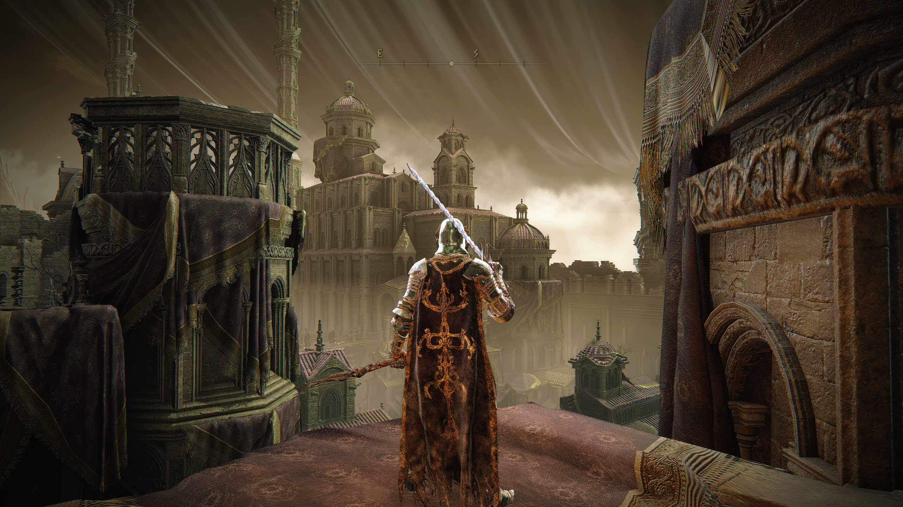

# Twin Lanterns downloads

## Kriegsspinne — Reference Build Candidate 1

[Download Kriegsspinne — Reference Build Candidate 1](Kriegsspinne-Reference-Build-Candidate-1.zip)
· [Install and matched comparison presets](../Twin-Lanterns/Provider-Performance/README.md)
· [SHA-256](Kriegsspinne-Reference-Build-Candidate-1.zip.sha256)

**Kriegsspinne** brands the corrected cached-bounce shader as **Reference Build
Candidate 1**. Shader code, defaults and preset identifiers are preserved.

Reuses captured first light in the production composite instead of rebuilding
it twice. Includes cached/recomputed comparison pairs with identical ray budgets.
Uses the Provider Performance effect identity: replace that folder rather than
installing a second copy. Ray coverage and bounce gathering remain unchanged.
CPU bounds/rounding and sampling checks pass; native compilation, visual quality
and GPU timing still need in-game verification.


[Previous corrected Cached Bounce ZIP](Twin-Lanterns-CachedBounce.zip) remains
available with its original download identity.

## Direction/Provider Performance Probe

[Download Provider Performance — ZIP](Twin-Lanterns-ProviderPerf.zip)
· [Preset sequence and measurement instructions](../Twin-Lanterns/Provider-Performance/README.md)
· [SHA-256](Twin-Lanterns-ProviderPerf.zip.sha256)

Based on Bounce Lab, this separates eight-versus-four direction cost from DDA
sample density and provider compilation. Start with **Cardinal4-EqualTraversal**,
**Diagonal4-EqualTraversal** and **Mixed8-EqualTraversal**. The mixed preset halves
per-direction sampling density while preserving reach; all three have the same
maximum traversal count. Full-density mixed, matched DDA-only/march-only, original
budget and first-pass-only controls are also included. Presets recompile provider
selection through ReShade preprocessor definitions.

No previous build is replaced. DX11/DX12 paths remain supported by design;
native compilation, image quality and GPU timing remain pending. The included
measurement matrix has no fabricated performance results.

## Bounce Lab

[Download Bounce Lab — ZIP](Twin-Lanterns-BounceLab.zip)
· [Controls, experiment sequence and limits](../Twin-Lanterns/Bounce-Lab/README.md)
· [SHA-256](Twin-Lanterns-BounceLab.zip.sha256)

An isolated voxel-free experiment with one extra gather of first-pass bounded
light. Distance and bounce retention reduce energy. Optional deterministic
direction dropout/diminishment simulates missing support without redistributing
its energy. A current-frame color anchor changes hue without increasing signal
luminance or peak. The source and first light remain when extra samples drop.

Compare **Reference → Bounce → BrokenSampler** at the same camera position.
The presets enable only Bounce Lab; keep other effects disabled. It has six
passes and five full-resolution working textures (about 140.6 MiB at 1440p).
Native ReShade compilation, appearance and GPU timing remain pending. There is
no temporal color memory, measured hidden occlusion or claim of a vision model.

## Direction Lab

[Download Direction Lab — ZIP](Twin-Lanterns-DirectionLab.zip)
· [Comparison instructions and diagnostic meanings](../Twin-Lanterns/Direction-Lab/README.md)
· [SHA-256](Twin-Lanterns-DirectionLab.zip.sha256)

An isolated voxel-free first-pass experiment: compare **four cardinal** with
**four diagonal** directions at equal sampling budgets and depth travel. Test
**eight mixed** directions separately. DDA and march can be selected individually;
new views show hit coverage, admitted weight, raw donor color and weighted light.
The three supplied presets differ only in Direction Set and enable only the lab
technique. Existing effects and Fog Guard should stay disabled for the comparison.
CPU/source/package checks are available; native ReShade compile and live testing
remain pending. This package does not add a second bounce.

## Twin Lanterns No Voxel

[Download No-Voxel test build + Fog Guard — ZIP](Twin-Lanterns-No-Voxel.zip)
· [Setup and scope](../Twin-Lanterns/No-Voxel/README.md)
· [SHA-256](Twin-Lanterns-No-Voxel.zip.sha256)

This separate build retains full-resolution DDA and parametric-march transport,
depth fade, light-only softening and bounded added light. Voxel lighting,
voxel controls/views, the compute pass and 3D atlas are removed. The starter
preset orders **Fog Guard Capture → Twin Lanterns No Voxel → Fog Guard Restore**.
Disable the original Crystal Spider technique when testing. Native ReShade
compilation, appearance and FPS still require in-game testing.

## Crystal Spider - Beta

**[Download Crystal Spider - Beta + Fog Guard — ZIP](https://raw.githubusercontent.com/alia-june/Lunar-Flower/main/downloads/Crystal-Spider-Beta.zip)** · [Crystal-only ZIP](https://raw.githubusercontent.com/alia-june/Lunar-Flower/main/downloads/Crystal-Spider-Beta-standalone.zip) · [Lazara](https://github.com/dastardlyrat/Lazara-Reshade-Revival-Package)

The main ZIP now bundles Crystal Spider and Fog Guard V2, their complete matching
includes, source notices and `Crystal-Spider-Beta.ini`. It contains **two effect
files and three techniques**, ordered **Capture → Crystal Spider → Restore**.
All 70 shader/include files are unchanged from the published standalone builds.

### Setup

1. Extract outside the shader search tree and merge only `reshade-shaders` into
   the existing game installation. Keep its `ReShade.fxh`.
2. Copy the included `Crystal-Spider-Beta.ini` into your preset folder and select
   it in ReShade for a fresh three-technique setup.
3. For an existing Lazara/custom stack, keep its preset and put Capture before
   the effects to protect and Restore after them. Set **Outside Shade = 0**;
   existing presets may retain an older `0.18` value.

[Full bundle instructions](../docs/CRYSTAL_SPIDER_BUNDLE.md) ·
[Inspect the starter preset](../presets/Crystal-Spider-Beta.ini).

### Lazara + Twin Lanterns

[](../Twin-Lanterns/assets/twin-lanterns-gallery-04.png)

*Elden Ring — Lazara + Twin Lanterns.* Original user-supplied 2560×1440 capture.

### Preserved controls and component evidence

The starter retains all 24 Crystal Spider values from the corrected user
`Lazara.ini`: Strength `0.272`, Front Bias `0.000052`, Ray Pairs `1`, Voxel
Lighting `1`, Voxel Steps `24`, Fade `0.355`, and Softening `1`, with the other
selected values unchanged. The original `DEFAULTS_FROM_PRESET.json` is included.
Fog Guard's 13 controls use shader defaults, with Outside Shade `0` and Strength
`1`; the separate curated Lazara preset has historically saved Strength `0.672`.

Crystal Spider's public identifiers and preset scales remain unchanged. The
[camera-dependent tile correction](../Twin-Lanterns/Full-Resolution-Dual-Ray-Alpha/TILE_ARTIFACT_FIX_NOTES.md)
uses fine-depth donor admission and a diagnostic-only atlas. The
[Fog Guard update](../development/fog-guard-v2/README.md) has user-reported
acceptance and CPU/package evidence. Packaging verifies include closure,
nonconflicting texture names, component bytes and preset wiring; it does not
claim a fresh native compile or combined GPU benchmark.

The standalone Crystal-only ZIP retains the original single-effect package,
notes and Crystal installation repair tool. Fog Guard remains separately
available below. Bundle installation uses the complete `reshade-shaders` folder
and the instructions above.

Bundle SHA-256:

```text
69884b754fe421c549d8f45b8608fc9455b405527522b8814d01416868e1269f
```

The adjacent `.zip.sha256` file records the same archive checksum.
`BUNDLE_MANIFEST.json` records the input archive hashes and bundled file hashes.

## Stable and Fidelity fine controls

| Build | Single-effect package |
| --- | --- |
| Stable 1.4 | [Download ZIP](https://raw.githubusercontent.com/alia-june/Lunar-Flower/fix/alpha-inactive-work-and-guides/downloads/Twin-Lanterns-Stable-1.4-fine-controls.zip) |
| Fidelity Overdrive | [Download ZIP](https://raw.githubusercontent.com/alia-june/Lunar-Flower/fix/alpha-inactive-work-and-guides/downloads/Twin-Lanterns-Fidelity-Overdrive-fine-controls.zip) |

Each ZIP contains exactly one effect, its matching includes, README, license
and lineage records. Merge the selected package's `reshade-shaders` folder
into the game installation; retain its known-good `ReShade.fxh`. Install one
selected build. The backport changes only Strength and Depth Agreement UI
annotations, with `0.001` and `0.00001` fine drag steps respectively. Names,
defaults, ranges, preset scales and rendering math are preserved.

The adjacent `.zip.sha256` files identify the archives. These packages are
on the review branch. CPU/source validation does not establish a fresh native
ReShade compile or visual acceptance of either backport.

## Fog Guard V2 for Lazara

[Download Fog Guard V2](https://raw.githubusercontent.com/alia-june/Lunar-Flower/main/downloads/Lazara-Fog-Guard-V2.zip).

Use **Fog Guard (Capture) → Crystal Spider/other effects → Fog Guard (Restore)**,
and set **Outside Shade to 0** in existing presets. This is a separate
single-effect Lazara package. The main Crystal Spider download also includes
this exact Fog Guard component.
[Installation, patch provenance and validation](../development/fog-guard-v2/README.md).
The user confirmed the fix works on November 10, 2026. Automated checks cover
CPU behavior and package integrity; native compile logs and GPU timings have
not been archived.
